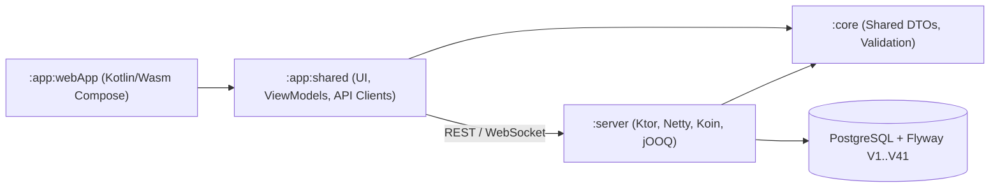
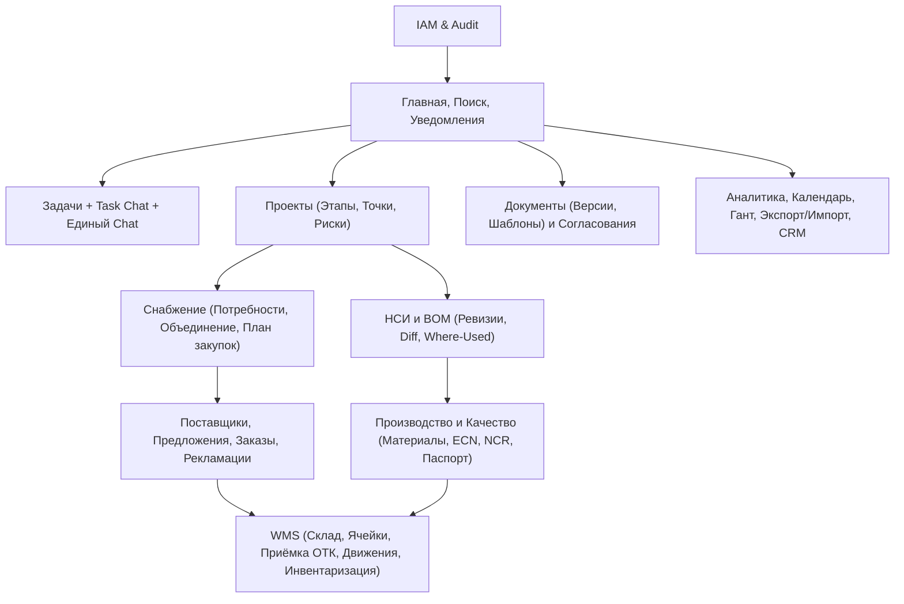

# Архитектура проекта

Проект состоит из четырёх Gradle-модулей. Сейчас это стартовый пример Kotlin Multiplatform: веб-интерфейс на Compose Multiplatform и отдельный сервер Ktor используют небольшую общую функцию приветствия. Прикладной логики для поставок в исходниках пока нет.

```text
:app:webApp  →  :app:shared  →  :core
:server                     →  :core
```

| Модуль | Назначение | Целевые платформы |
| --- | --- | --- |
| [`:core`](../core/) | Общая функция `sayHello(to)`, доступная интерфейсу и серверу. | JVM, JS, Wasm JS |
| [`:app:shared`](../app/shared/) | Compose UI (`App`), класс `Greeting` и платформенная реализация `getPlatform()`. Зависит от `:core`. | JS, Wasm JS |
| [`:app:webApp`](../app/webApp/) | Веб-точка входа `main()`: создаёт `ComposeViewport` и вызывает `App()`. Зависит от `:app:shared`. | JS, Wasm JS |
| [`:server`](../server/) | JVM-приложение Ktor/Netty с HTTP-маршрутом `/`. Зависит от `:core`. | JVM |

## Потоки выполнения

Веб-страница из [`index.html`](../app/webApp/src/webMain/resources/index.html) загружает приложение. [`main.kt`](../app/webApp/src/webMain/kotlin/org/example/project/main.kt) монтирует Compose UI. После нажатия кнопки `App()` показывает результат `Greeting().greet()`. `Greeting` получает имя платформы через `expect/actual getPlatform()` и передаёт его в общую `sayHello()`.

Для JS имя платформы определяется из браузерного `userAgent`; для Wasm JS используется строка `Web with Kotlin/Wasm`. Реализации находятся соответственно в [`jsMain`](../app/shared/src/jsMain/kotlin/org/example/project/Platform.js.kt) и [`wasmJsMain`](../app/shared/src/wasmJsMain/kotlin/org/example/project/Platform.wasmJs.kt).

Сервер запускает Netty на порту 8080. Обработчик `GET /` вызывает `sayHello("Ktor")` и возвращает текстовый ответ. В исходниках нет вызова сервера из веб-приложения: эти две точки входа работают независимо, разделяя только модуль `:core`.

Состав модулей задаёт [`settings.gradle.kts`](../settings.gradle.kts), а версии зависимостей — [`gradle/libs.versions.toml`](../gradle/libs.versions.toml).

## Диаграмма архитектуры (Mermaid)



## Бизнес-модули ERP


