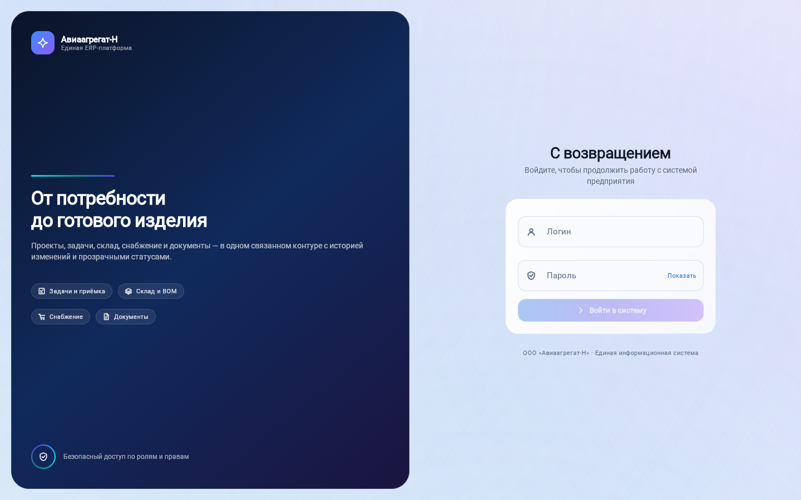
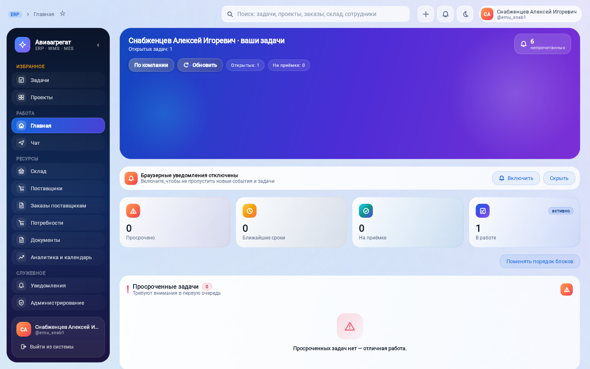
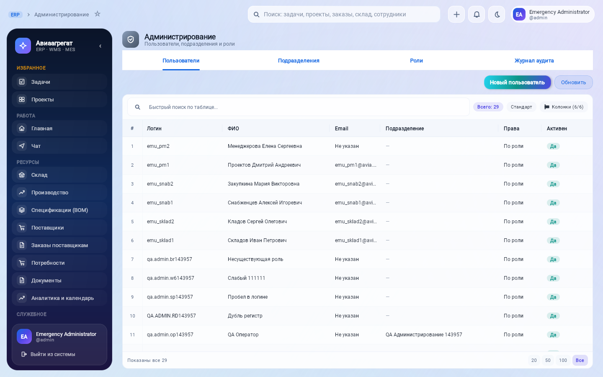

# Руководство по эксплуатации ERP «Авиаагрегат-Н» (простым языком + FAQ)

Это пошаговое руководство для новых сотрудников. Здесь без сложных терминов объяснено, как устроена система, в каком порядке нажимать кнопки и что делать, если что-то «не даёт сохранить» или выдаёт ошибку.

---

## 1. Вход в систему и главный экран

1. Откройте в браузере адрес системы (например, `http://localhost:8091`).
2. Введите **Логин** и **Пароль**, выданные администратором (если нужно проверить пароль — нажмите **«Показать»**).
3. Нажмите **«Войти в систему»**.

### Что где находится после входа
- **Левое меню** — разделы системы (вы видите только те разделы, к которым у вашей роли есть доступ):
  - **Задачи** и **Проекты** — ваша ежедневная работа и поручения.
  - **Главная** и **Чат** — сводка по вашим задачам/уведомлениям и все переписки.
  - **Склад**, **Поставщики**, **Заказы поставщикам**, **Потребности**, **Производство**, **Документы** — рабочие модули.
  - **Уведомления**, **Администрирование**, **Профиль** — служебные разделы.
- **Верхняя панель** — быстрый поиск по всей системе (задачи, проекты, заказы, склад, сотрудники), кнопка быстрого создания (`+`), колокольчик уведомлений и ваш профиль.

> **Совет:** Нажмите **«Включить»** на баннере уведомлений, чтобы браузер показывал вам оповещения о новых задачах и сообщениях.

---

## 2. Как работать с задачами

Откройте раздел **«Задачи»** в левом меню. Вверху находятся быстрые фильтры: *Все*, *В работе*, *На приёмке*, *Блок*, *Завершённые*.

### Какой путь проходит задача
1. **Назначена (`ASSIGNED`)** — задачу создали для вас. Откройте её и нажмите **«Принять» / «Начать работу»**, чтобы она перешла в статус **«В работе»**.
2. **В работе (`IN_PROGRESS`)** — выполняйте задачу. Вопросы можно писать прямо внутри карточки задачи во вкладке **«Чат задачи»** (переписка привязана к этой задаче и не потеряется).
3. **Завершение** зависит от типа задачи:
   - **Обычная задача (`GENERAL`)**: отправьте результат (комментарий/итог) и закройте задачу. Кнопки «На приёмку» у неё нет.
   - **Задача с приёмкой (`REVIEWED`)**: у такой задачи обязательно заполнены **«Критерии приёмки»** и назначен **Проверяющий**. Сначала отправьте результат, затем нажмите **«Отправить на приёмку»** — задача перейдёт в статус **«На приёмке»**, и её должен подтвердить проверяющий.
4. **Заблокирована (`BLOCKED`)** — если работу нельзя продолжить (ждёте деталь, решение, ответ), нажмите **«Заблокировать»**, укажите причину и ответственного за разблокировку. После снятия блока задача вернётся в прежний статус.

---

## 3. Проекты (для руководителей и участников)

Откройте раздел **«Проекты»**. Здесь виден портфель проектов, статусы, руководитель, приоритет и сроки.

### Как запустить новый проект
1. Нажмите **«+ Новый проект»**, заполните название, тип, приоритет, заказчика и плановые даты.
2. Новый проект всегда создаётся в статусе **«Черновик (откройте проект)»**.
3. Откройте карточку проекта:
   - На вкладке **«Обзор»** можно нажать **«Открыть проект»** (указав причину открытия — например, *«Запуск работ по договору»*).
   - Добавьте **участников** проекта, чтобы коллеги из снабжения и склада видели проект и его чат.
   - На вкладке **«Этапы»** заведите этапы и контрольные точки (вехи).
   - На вкладке **«Риски»** фиксируйте возможные задержки (срок указывается в формате `ГГГГ-ММ-ДД` через календарь).
   - На вкладке **«Обсуждение»** находится общий **Чат проекта** — пишите туда важные новости для всей команды.

---

## 4. Снабжение: от потребности до заказа поставщику

В системе заказы поставщикам не создаются «с нуля в одну кнопку» — они всегда опираются на **потребность** и **выбранное коммерческое предложение**.

### Правильный порядок действий (чтобы ничего не заблокировалось)
1. **Потребность (`DM-...`)**: убедитесь, что есть заявка/потребность на закупку нужной номенклатуры.
2. **Поставщик (`SUP-...`)**: в разделе **«Поставщики»** проверьте, что контрагент есть в базе.
   - **Важно:** заказывать можно только у **проверенного (`VERIFIED`)** поставщика. Если поставщик новый (`Не проверен`), сотрудник с правом верификации должен подтвердить его в карточке поставщика.
3. **Коммерческое предложение (`OFF-...`)**: создайте предложение от поставщика на нужную строку потребности.
4. **Выбор предложения (`SELECTED`)**: **инициатор потребности** (или сотрудник с правом выбора) должен выбрать лучшее предложение. Только после этого из него можно сделать заказ!
5. **Заказ поставщику (`PO-...`)**:
   - Нажмите **«+ Новый заказ»**, выберите одобренное предложение (`SELECTED`), укажите склад доставки (`WH-01`) и ожидаемую дату.
   - Отправьте заказ **на согласование** (`PENDING_APPROVAL`).
   - Когда руководитель/согласующий нажмёт **«Утвердить»** (`APPROVED`), нажмите **«Отправить поставщику»** (`SENT`).
   - **Только после статуса `Отправлен` (`SENT`) склад увидит этот заказ в «Ожидаемых поступлениях»!**

---

## 5. Склад (WMS): остатки, приёмка, перемещение и выдача

Откройте раздел **«Склад»**. Внутреннее меню разделено на операции и справочники.

### Три главных числа в «Остатках» (не путайте их!)
- **Физически** — сколько всего штук/кг физически лежит на полках.
- **В резерве** — сколько из них уже «забронировано» под конкретные заказы или производство.
- **Доступно** — сколько можно прямо сейчас выдать или переместить (`Физически − В резерве`).
- **Карантин / брак** — товар в карантинных/бракованных ячейках; в обычный расход он не идёт.

### Как принять товар от поставщика («Приёмка»)
1. Перейдите в **«Склад» → «Приёмка»**.
2. В блоке **«Ожидаемые поступления»** выберите отправленный заказ (`PO-...`) или создайте приёмку по накладной (`DELIVERY_NOTE`).
3. Укажите **склад** и **ячейку хранения** (например, `B-02-01`) для каждой строки и сохраните — получится **Черновик (`DRAFT`)**.
   - **Важно:** пока приёмка в статусе «Черновик», **остатки на складе не увеличиваются!**
4. Сверьте фактическое количество и нажмите **«Провести» (`POSTED`)** — только после этого товар появится на остатках.

### Как выдать или переместить товар
- **Выдача (`ISS-...`)**: создайте документ выдачи (выберите основание — *Проект*, *Задача* или *Производство*) → подберите строки из ячеек (**«Отобрать»**) → нажмите **«Выдать»** → получатель нажимает **«Подтвердить получение»**.
  - *Важно:* если выбрано основание «Проект», поле «Задача» должно оставаться пустым.
- **Перемещение (`TRF-...`)**: выберите ячейку-отправитель и ячейку-получатель (они не должны совпадать) → **«Отгрузить»** → **«В пути»** → **«Принять»**.

---

## 6. Администрирование (для администратора)

Раздел **«Администрирование»** содержит 4 вкладки: **Пользователи**, **Подразделения**, **Роли**, **Журнал аудита**.

- **Пользователи:** создание учётных записей, смена подразделения, сброс пароля и деактивация.
  - **Осторожно при редактировании!** Если в окне изменения пользователя поставить галочку **«Изменить роли (заменяет текущий набор)»**, нужно заново отметить все нужные ему роли — иначе старые роли сотрутся.
- **Подразделения:** дерево отделов и назначение руководителей.
- **Роли:** просмотр ролей (`ADMIN`, `PM`, `BUYER`, `KEEPER`, `ENGINEER`, `MASTER`, `SUPPLY_CHIEF`) и привязанных к ним прав.
- **Журнал аудита:** история всех действий в системе (кто, когда и что создал, изменил или отправил).

---

## 7. FAQ — Частые вопросы и решения проблем

**1. Почему я создал проект, а он называется «Черновик (откройте проект)»?**  
Все новые проекты создаются как черновик. Зайдите в проект и нажмите «Открыть проект», указав короткую причину. При этом добавлять участников, создавать задачи и писать в чат проекта можно сразу.

**2. Почему при создании задачи система ругается и не сохраняет?**  
Проверьте два частых момента:
- Выбран тип задачи **с приёмкой (`REVIEWED`)**, но не заполнены **«Критерии приёмки»** или не указан **Проверяющий**.
- Срок задачи введён в неверном формате (пользуйтесь кнопкой календаря).

**3. Почему у обычной задачи нет кнопки «Отправить на приёмку»?**  
Кнопка приёмки есть только у задач типа `REVIEWED` (с проверкой). Обычная задача (`GENERAL`) закрывается после отправки результата без отдельного этапа приёмки.

**4. Почему в «Заказах поставщикам» кнопка «Создать заказ» неактивна?**  
Заказ можно создать только на основе **выбранного коммерческого предложения (`SELECTED`)**. Если ни одного предложения ещё не выбрали, перейдите в **«Поставщики» → «Предложения»** и выберите подходящее (или попросите сделать это инициатора потребности).

**5. Я снабженец и создал нового поставщика и предложение, почему не могу оформить заказ?**  
Для заказа нужны два предварительных шага от уполномоченных сотрудников:
1. Поставщик должен пройти проверку (**статус `VERIFIED`**).
2. Предложение должен выбрать **инициатор потребности** (или пользователь с правом выбора любых предложений).

**6. Почему я (снабженец) отправил заказ на согласование, но не могу отправить его поставщику?**  
После статуса **«На согласовании» (`PENDING_APPROVAL`)** заказ должен **утвердить (`APPROVED`)** руководитель/согласующий с правом утверждения заказов. Только потом появится кнопка «Отправить поставщику».

**7. Почему склад не видит заказ в «Ожидаемых поступлениях»?**  
Склад видит только заказы, которые уже **отправлены поставщику** (статус `SENT`, `PARTIALLY_DELIVERED` или `DELIVERED`). Черновики и заказы на согласовании кладовщику не показываются.

**8. Я оформил приёмку на складе, но в «Остатках» товар не появился. Почему?**  
Вы сохранили **черновик приёмки (`DRAFT`)**. Чтобы товар зачислился на остатки, откройте приёмку и нажмите **«Провести» (`POSTED`)**.

**9. На складе товар «Физически» есть, а «Выдать» или «Переместить» не даёт — пишет, что не хватает количества.**  
Смотрите колонку **«Доступно»**, а не «Физически». Часть товара может быть **«В резерве»** под другой заказ либо находиться в ячейке **«Карантин / брак»**, откуда обычная выдача запрещена.

**10. При попытке выдать товар со склада появляется ошибка «Nothing picked for the issue order».**  
Перед нажатием «Выдать» нужно указать, из какой конкретно ячейки берётся товар: откройте документ выдачи и выполните подбор (**«Отобрать»** из ячейки).

**11. Почему не получается создать счёт поставщика без файла?**  
По правилам системы к счёту поставщика обязательно прикрепляется скан/файл документа. Сначала прикрепите файл, затем сохраните счёт.

**12. Появилась ошибка «Конфликт версий / Запись была изменена другим пользователем» (`409 Conflict`). Что делать?**  
Кто-то из коллег обновил этот документ/задачу раньше вас, пока карточка была у вас открыта. Нажмите **«Обновить»**, проверьте актуальный статус и повторите действие.

**13. Что делать, если в списке после создания записи её сразу не видно?**  
Нажмите кнопку **«Обновить»** в правом верхнем углу таблицы — список подгрузит свежие данные с сервера.
