# Руководство по эксплуатации ERP «Авиаагрегат-Н» (простым языком + FAQ)

Это пошаговое руководство для новых сотрудников. Здесь без сложных терминов объяснено, как устроена система, в каком порядке нажимать кнопки и что делать, если что-то «не даёт сохранить» или выдаёт ошибку.

---

## 1. Вход в систему и главный экран

1. Откройте в браузере адрес системы (например, `http://localhost:8091`).
2. Введите **Логин** и **Пароль**, выданные администратором (если нужно проверить пароль — нажмите **«Показать»**).
3. Нажмите **«Войти в систему»**.

### Что где находится после входа
- **Левое меню** — разделы системы (вы видите только те разделы, к которым у вашей роли есть доступ):
  - **Задачи** и **Проекты** — ваша ежедневная работа и поручения.
  - **Главная** и **Чат** — сводка по вашим задачам/уведомлениям и все переписки.
  - **Склад**, **Поставщики**, **Заказы поставщикам**, **Потребности**, **Производство**, **Документы** — рабочие модули.
  - **Уведомления**, **Администрирование**, **Профиль** — служебные разделы.
- **Верхняя панель** — быстрый поиск по всей системе (задачи, проекты, заказы, склад, сотрудники), кнопка быстрого создания (`+`), колокольчик уведомлений и ваш профиль.

> **Совет:** Нажмите **«Включить»** на баннере уведомлений, чтобы браузер показывал вам оповещения о новых задачах и сообщениях.

---

## 2. Как работать с задачами

Откройте раздел **«Задачи»** в левом меню. Вверху находятся быстрые фильтры: *Все*, *В работе*, *На приёмке*, *Блок*, *Завершённые*.

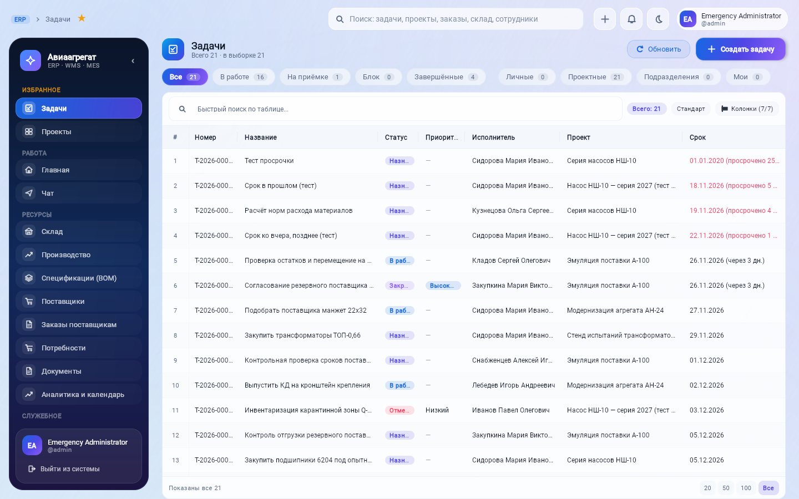

### Какой путь проходит задача
1. **Назначена (`ASSIGNED`)** — задачу создали для вас. Откройте её и нажмите **«Принять» / «Начать работу»**, чтобы она перешла в статус **«В работе»**.
2. **В работе (`IN_PROGRESS`)** — выполняйте задачу. Вопросы можно писать прямо внутри карточки задачи во вкладке **«Чат задачи»** (переписка привязана к этой задаче и не потеряется).
3. **Завершение** зависит от типа задачи:
   - **Обычная задача (`GENERAL`)**: отправьте результат (комментарий/итог) и закройте задачу. Кнопки «На приёмку» у неё нет.
   - **Задача с приёмкой (`REVIEWED`)**: у такой задачи обязательно заполнены **«Критерии приёмки»** и назначен **Проверяющий**. Сначала отправьте результат, затем нажмите **«Отправить на приёмку»** — задача перейдёт в статус **«На приёмке»**, и её должен подтвердить проверяющий.
4. **Заблокирована (`BLOCKED`)** — если работу нельзя продолжить (ждёте деталь, решение, ответ), нажмите **«Заблокировать»**, укажите причину и ответственного за разблокировку. После снятия блока задача вернётся в прежний статус.

---

## 3. Проекты (для руководителей и участников)

Откройте раздел **«Проекты»**. Здесь виден портфель проектов, статусы, руководитель, приоритет и сроки.

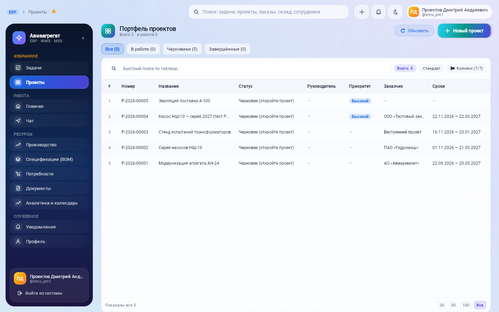

### Как запустить новый проект
1. Нажмите **«+ Новый проект»**, заполните название, тип, приоритет, заказчика и плановые даты.
2. Новый проект всегда создаётся в статусе **«Черновик (откройте проект)»**.
3. Откройте карточку проекта:
   - На вкладке **«Обзор»** можно нажать **«Открыть проект»** (указав причину открытия — например, *«Запуск работ по договору»*).
   - Добавьте **участников** проекта, чтобы коллеги из снабжения и склада видели проект и его чат.
   - На вкладке **«Этапы»** заведите этапы и контрольные точки (вехи).
   - На вкладке **«Риски»** фиксируйте возможные задержки (срок указывается в формате `ГГГГ-ММ-ДД` через календарь).
   - На вкладке **«Обсуждение»** находится общий **Чат проекта** — пишите туда важные новости для всей команды.

---

## 4. Снабжение: от потребности до поступления на склад

Заказ поставщику не создаётся «с нуля». Цепочка всегда одна:

**Потребность (`DM-…`) → Поставщик (`SUP-…`, проверен) → Предложение (`OFF-…`, выбрано) → Заказ (`PO-…`, согласован и отправлен) → Счёт поставщика (сверен) → Приёмка на складе (`RCP-…`, проведена).**

Кто что делает (роли в типовой настройке):

| Шаг | Кто | Нужное право |
|---|---|---|
| Создать потребность | инженер, РП, снабженец | `demands:create` |
| Согласовать потребность | начальник снабжения | `demands:approve` |
| Завести поставщика, внести предложение | снабженец | `suppliers:create`, `suppliers:offer` |
| Проверить поставщика | начальник снабжения | `suppliers:verify` |
| Выбрать предложение | инициатор потребности или сотрудник с правом выбора | `suppliers:select` |
| Создать заказ, отправить поставщику | снабженец | `suppliers:order` |
| Согласовать заказ | начальник снабжения | `suppliers:approve_order` |
| Загрузить и сверить счёт, передать складу | снабженец | `invoices:manage` |
| Принять товар и провести приёмку | кладовщик | `wms:post` |

### 4.1. Потребности и единый пульт потребности (D-64)

Раздел **«Потребности»** — список заявок на закупку: номер, основание, проект, приоритет, статус, требуемая дата.

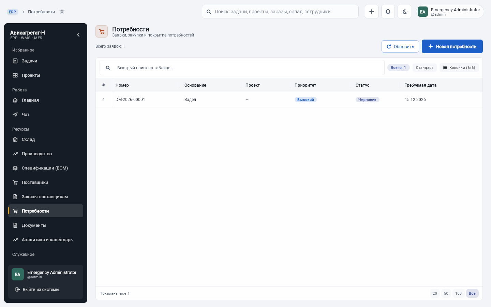

**Новая потребность** (кнопка **«+ Новая потребность»**):

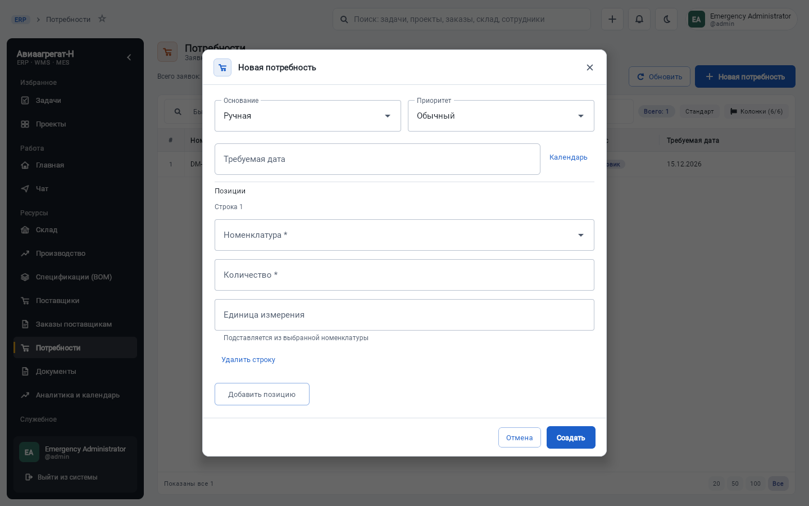

| Поле | Что вводить |
|---|---|
| Основание | **Ручная** — разовая закупка; **Задел** — закупка впрок (появится обязательное поле «Обоснование задела»); **Проект** — потребность из проекта и спецификации (BOM). |
| Приоритет | Низкий / Обычный / Высокий / Критичный. Влияет на очерёдность работы снабжения. |
| Требуемая дата | К какой дате материал нужен. Выбирайте через «Календарь». |
| Позиции → Номенклатура \* | Что купить. Выбирается из справочника номенклатуры. |
| Позиции → Количество \* | Сколько нужно. |
| Позиции → Единица измерения | Подставляется из номенклатуры, менять не нужно. |
| Добавить позицию / Удалить строку | Добавить ещё одну строку или убрать лишнюю. |

> **Важное правило (D-64):** Новая потребность **сразу переходит в статус `APPROVED`** (автоматически фиксируется автор и время создания) и **сразу доступна снабжению** для внесения коммерческих предложений. Промежуточное согласование заявки упразднено.

**Карточка потребности (Единый пульт):**
Кликните по потребности в списке, чтобы открыть её карточку. Это **единый пульт управления**, объединяющий все этапы (Заявка → Предложения → Выбрано → Оплачено → На складе), позиции со складским остатком, предложения поставщиков со счетами и статус приёмки в одном окне. Отдельный экран «Покрытие» не используется.

- Таблица **«Позиции»**: *Кол-во* — сколько нужно; *Покрыто* — сколько уже обеспечено; *Дефицит* — сколько ещё надо купить; *Статус* строки.
- Ведущий инженер может **выбрать предложение** в 1 клик прямо в карточке потребности.
- Снабженец (`suppliers:order`) нажимает **«Отметить Оплачено»** прямо в карточке потребности: заказ поставщику автоматически создается/переводится в статус `SENT` с фиксацией времени и автора оплаты без ручного промежуточного согласования заказа и сразу попадает в очередь приёмки склада.

Статусы потребности: Approved (Утверждена) → В закупке → Частично покрыта → Покрыта (или Отменена).

### 4.2. Поставщики и их проверка

Раздел **«Поставщики»**, вкладка **«Поставщики»**: слева список, справа карточка выбранного контрагента.

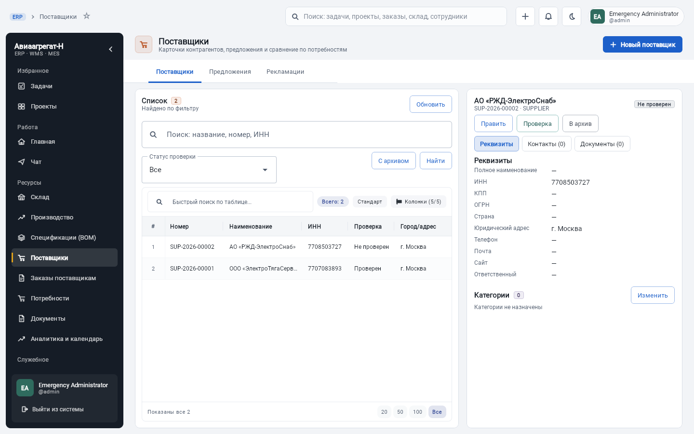

- **Поиск** — по названию, номеру `SUP-…` или ИНН; **Статус проверки** — фильтр; **С архивом** — показать и архивные карточки.
- В карточке: **Править**, **Проверка**, **В архив**; вкладки **Реквизиты**, **Контакты**, **Документы**; блок **Категории** (по каким группам товаров работает поставщик, кнопка «Изменить»).

**Новый поставщик** (кнопка **«+ Новый поставщик»**):

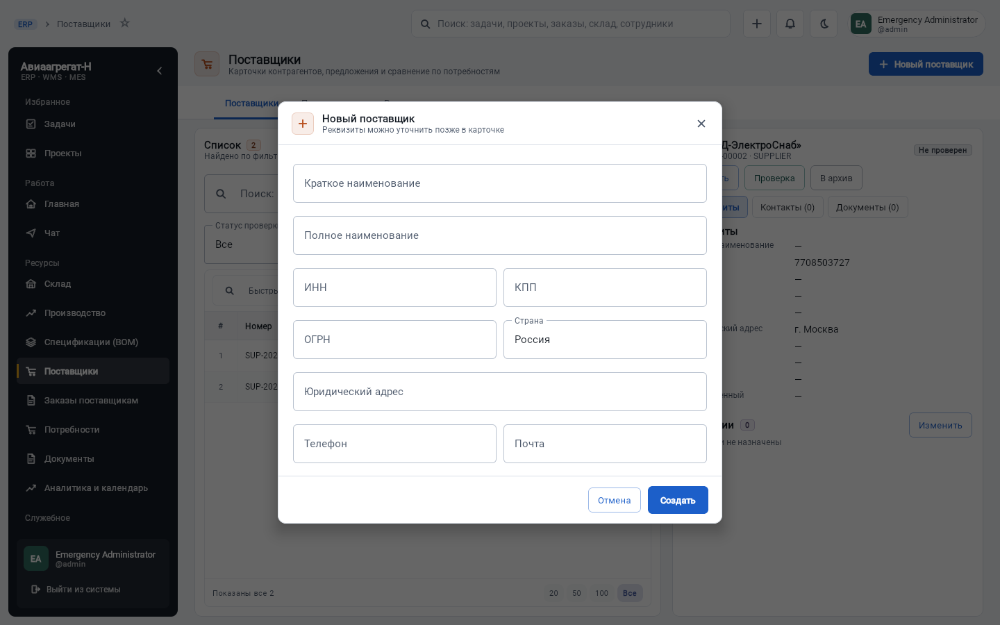

| Поле | Что вводить |
|---|---|
| Краткое наименование | Как называть в списках, например `ООО «Ромашка»`. |
| Полное наименование | По учредительным документам. |
| ИНН / КПП / ОГРН | Реквизиты; по ИНН потом сверяется счёт поставщика. |
| Страна | По умолчанию «Россия». |
| Юридический адрес, Телефон, Почта | Контакты организации. |

Реквизиты можно дополнить позже кнопкой «Править».

**Проверка контрагента** (кнопка **«Проверка»** в карточке):

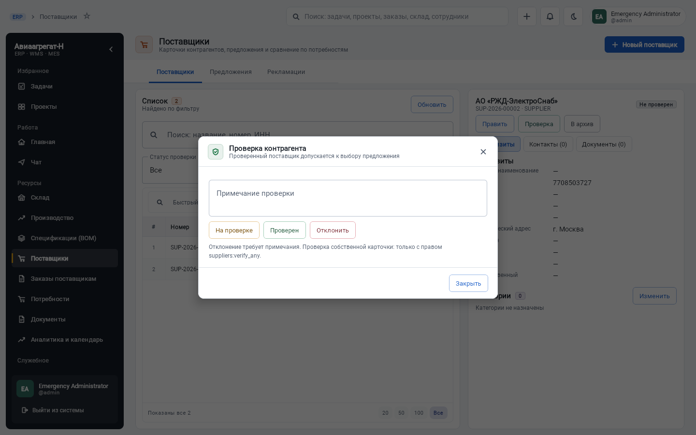

- **Примечание проверки** — что проверено (выписка ЕГРЮЛ, отзывы и т. п.). Для «Отклонить» обязательно.
- **На проверке** / **Проверен** / **Отклонить** — новый статус. Предложение можно выбрать **только у проверенного** поставщика.
- Свою собственную карточку проверяет только сотрудник с правом `suppliers:verify_any`.

### 4.3. Предложения поставщиков и выбор

Вкладка **«Предложения»** раздела «Поставщики». Слева — все предложения, справа — сравнение по выбранной потребности.

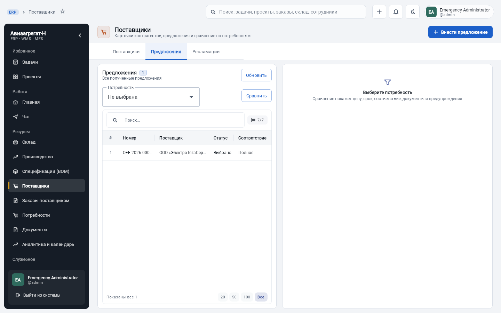

- **Потребность** + **Сравнить** — сравнение предложений по одной потребности: цена, срок, соответствие ТЗ, документы, предупреждения. Метки **«Минимальная цена»** и **«Рекомендуем»** — подсказки.
- **Выбрать** / **Снять выбор** — выбор победителя. Делает инициатор потребности (или пользователь с `suppliers:select`). Из выбранного предложения (статус **«Выбрано»**) затем создаётся заказ.

**Внести предложение** (кнопка вверху справа):

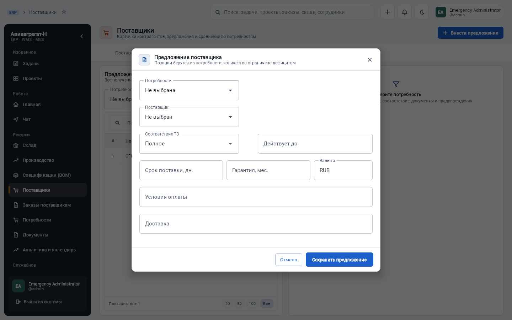

| Поле | Что вводить |
|---|---|
| Потребность | По какой потребности предложение. Позиции подтянутся из неё. |
| Поставщик | От кого предложение. |
| **Счёт поставщика (файл) \*** | **Обязательное поле (D-64):** выберите загруженный файл счёта поставщика (документ DMS типа `INVOICE`). Без прикрепленного файла счёта коммерческое предложение не создается. Ведущий сможет открыть PDF счёта прямо при выборе варианта. |
| Соответствие ТЗ | Насколько предложение соответствует техническим требованиям потребности. |
| Действует до | Срок действия предложения (после него статус «Истекло»). |
| Срок поставки, дн. | Через сколько дней после заказа поставщик отгрузит товар. |
| Гарантия, мес. | Гарантийный срок. |
| Валюта | По умолчанию RUB. |
| Условия оплаты | Например «50% предоплата, 50% по факту». |
| Доставка | Самовывоз, доставка до склада и т. п. |
| Строки: Кол-во / Цена / НДС % | По каждой позиции потребности. Количество не больше дефицита. |

Статусы предложения: Получено, В шорт-листе, Выбрано, Отклонено, Отозвано, Истекло.

### 4.4. Заказы поставщикам

Раздел **«Заказы поставщикам»**, вкладки **Заказы**, **Поставки**, **Счета**.

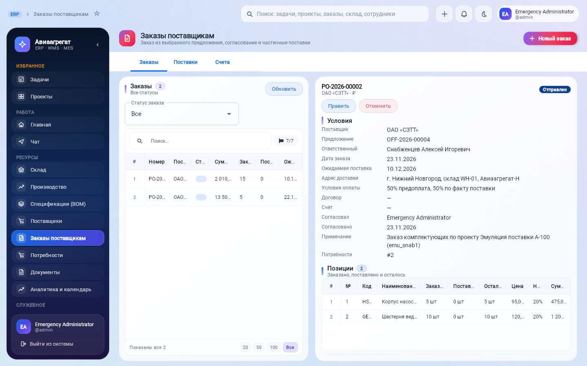

Карточка заказа (справа):
- **Условия** — поставщик, предложение-основание, ответственный, дата заказа, **ожидаемая поставка** (плановая дата прихода), адрес доставки, условия оплаты, договор, счёт, кто и когда согласовал, связанные потребности.
- **Позиции** — по каждой строке *заказано*, *поставлено*, *осталось*.
- Внизу — суммы **без НДС**, **НДС**, **с НДС**.
- Ниже — **Поставки по заказу**, **Счета по заказу**, **История**.

**Новый заказ** (кнопка **«+ Новый заказ»**):

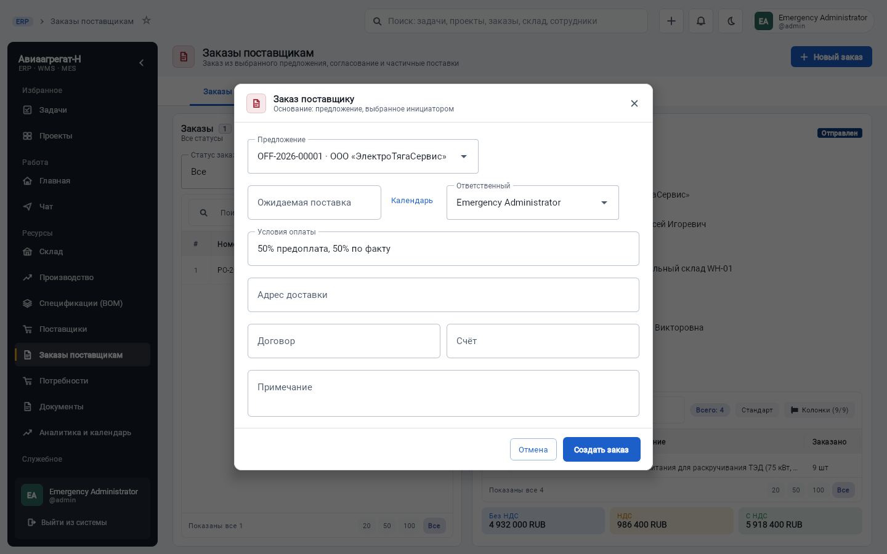

| Поле | Что вводить |
|---|---|
| Предложение | Только предложения в статусе «Выбрано». Поставщик, позиции и цены берутся из него. |
| Ожидаемая поставка | Плановая дата прихода товара. |
| Ответственный | Снабженец, который ведёт заказ. |
| Условия оплаты | Подставляются из предложения, можно уточнить. |
| Адрес доставки | Куда везти, например «г. Москва, Центральный склад WH-01». |
| Договор / Счёт | Номера, если уже известны. |
| Примечание | Свободный комментарий. |

Кнопки в карточке заказа по статусам:

| Статус | Кнопки | Кто |
|---|---|---|
| Черновик | **Править**, **На согласование**, **Отменить** | снабженец |
| На согласовании | **Согласовать** | согласующий (`suppliers:approve_order`) |
| Согласован | **Отправить поставщику**, **Загрузить счёт** | снабженец |
| Отправлен / Частично поставлен | **Принять** (регистрация поставки), **Загрузить счёт** | снабженец |
| Поставлен | **Закрыть** | снабженец |

Если после согласования изменить существенные условия («Править», поле «Обоснование изменения»), появится метка **«Нужно согласование»**: отправить поставщику можно будет только после повторного согласования.

**Склад видит заказ в «Ожидается к приёмке» только со статуса «Отправлен».** Черновики и заказы на согласовании кладовщику не показываются.

### 4.5. Поставки по заказу (вкладка «Поставки»)

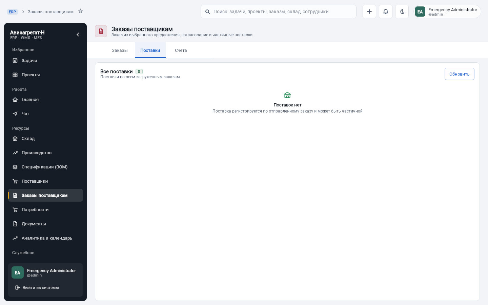

Поставка — отметка снабжения «поставщик привёз часть заказа». Кнопка **«Принять»** в карточке отправленного заказа открывает **«Регистрацию поставки»**: *Дата поставки*, *Документ-основание*, *Накладная / УПД*, *Примечание* и по каждой позиции *Принято*. Заказ переходит в «Частично поставлен» / «Поставлен». Ошибочную поставку можно отменить с причиной — остаток вернётся.

> В очереди «Ожидается к приёмке» на складе видно отдельно: **поставлено** — по поставкам, которые зарегистрировало снабжение; **принято** — по проведённым приёмкам склада; **осталось** — ещё не принято складом.

### 4.6. Счёт поставщика и передача на склад (вкладка «Счета»)

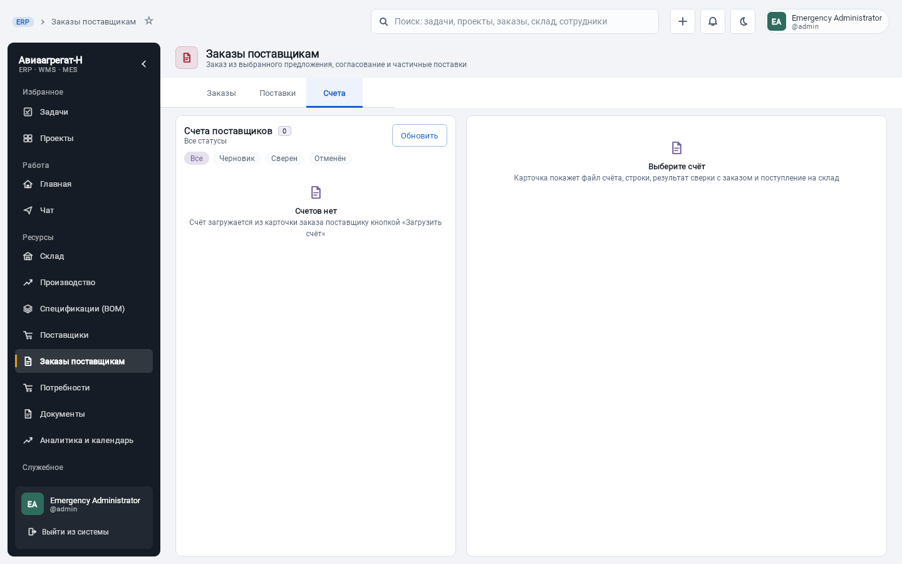

Счёт загружают из карточки согласованного или отправленного заказа кнопкой **«Загрузить счёт»**. **Без файла счёт не сохраняется.**

| Поле | Что вводить |
|---|---|
| Выбрать файл | PDF или скан счёта. Обязательно. |
| Заполнить из текста счёта | Вставьте текст из PDF или письма и нажмите «Распознать и заполнить» — номер, дата, ИНН/КПП и строки подставятся. |
| Номер счёта, Дата счёта, Действует до | Из документа. Номер уникален в пределах поставщика. |
| ИНН / КПП поставщика из счёта | Сверяются с карточкой поставщика. |
| Условия оплаты, Предоплата %, Срок изготовления, Условия доставки | Из счёта. |
| Назначение платежа, Менеджер поставщика | Для оплаты и связи. |
| Строки: Код поставщика, Наименование в счёте, Кол-во, Цена, НДС %, Сумма НДС, Сумма | Как в документе. Каждая строка сопоставляется с позицией заказа. |
| Итого без НДС / НДС / Итого с НДС | Подставляются по строкам; если в документе другие цифры — введите как в документе, расхождение покажет сверка. |

Дальше в карточке счёта:
1. **Сверка с заказом** — система сравнивает счёт с заказом: ошибки (подтвердить нельзя), расхождения (можно подтвердить с обоснованием), предупреждения.
2. **Подтвердить сверку** → счёт «Сверен». При расхождениях заполните «Обоснование (кто и почему согласовал расхождение)».
3. **Оформить поступление на склад** → выберите **Склад приёмки** → **Передать складу**. Склад увидит поступление в очереди **«Ожидается к приёмке по счетам от снабжения»** и примет товар (раздел 5.4).
4. **Вернуть в черновик** — пока поступление не оформлено; **Отменить счёт** — с причиной.

---

## 5. Склад (WMS)

Раздел **«Склад»**. Вверху вкладки: **Остатки**, **Приёмка**, **Выдача**, **Движения**, **Номенклатура**, меню **Операции ▾** (Резервы, Перемещения, Возвраты, Списания, Инвентаризация) и **Справочники ▾** (Склады, Ячейки). Число в скобках — количество записей.

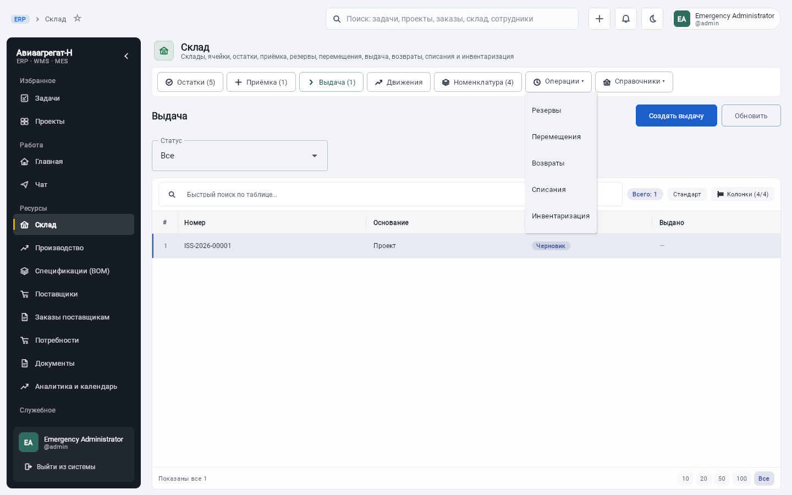

### 5.1. Остатки

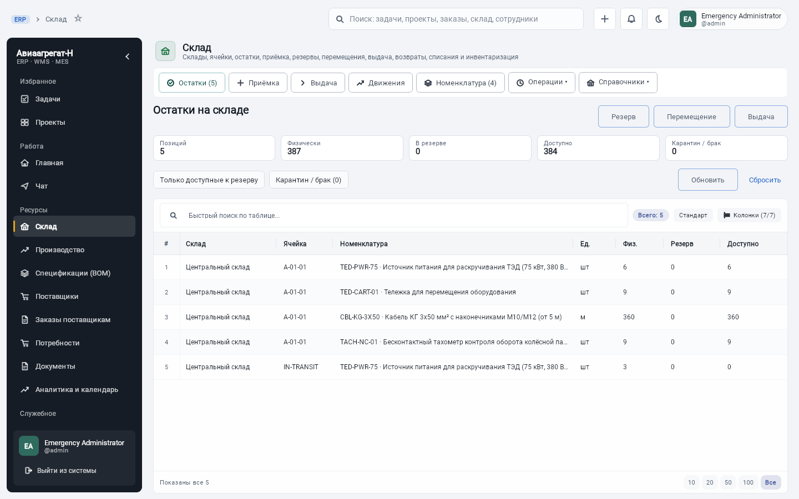

| Показатель | Что значит |
|---|---|
| **Физически** | Сколько лежит во всех ячейках. |
| **В резерве** | Сколько закреплено за проектами, заказами, задачами. |
| **Доступно** | Можно выдать или переместить прямо сейчас: свободный остаток без резерва, карантина, брака и транзитных ячеек. |
| **Карантин / брак** | Товар в ячейках с назначением «Карантин» и «Брак». В обычный расход не идёт. |

Кнопки над таблицей — **Резерв**, **Перемещение**, **Выдача** — открывают соответствующий документ. Фильтры: **Только доступные к резерву**, **Карантин / брак**, поиск по таблице. Колонки: Склад, Ячейка, Номенклатура, Ед., Физ., Резерв, Доступно. Ячейка `IN-TRANSIT` — товар в пути при перемещении между складами, он недоступен; в списках выбора ячеек её нет — она заполняется перемещением автоматически. Дробные количества и цены можно вводить и через запятую («10,5»), и через точку.

### 5.2. Приёмка: список и очередь ожидаемых поступлений (D-64)

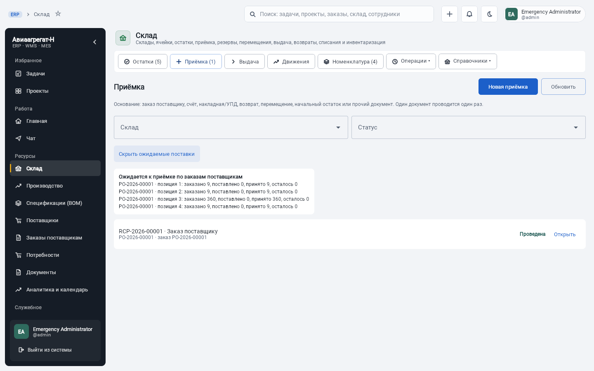

- Фильтры **Склад** и **Статус**.
- **Очередь «Ожидается к приёмке»**: в верхней части кладовщик видит оплаченные снабжением заказы (после того, как снабженец нажал кнопку «Отметить Оплачено» в карточке потребности).
- Нажмите на заказ или создайте приёмку, укажите склад и ячейку, после чего проведите приёмку в 1 шаг. Сервер автоматически обновит принятые количества, `covered_quantity` и статус связанных потребностей, а также отправит уведомления инициатору и снабженцу.
- Ниже — список приёмок `RCP-…` со статусом и кнопкой **«Открыть»**.

Статусы приёмки: **Черновик** → **В работе** → **Проведена** (или Отменена). **Пока приёмка не проведена, остатки не меняются.**

### 5.3. Новая приёмка: описание каждого поля

Кнопка **«Новая приёмка»**.

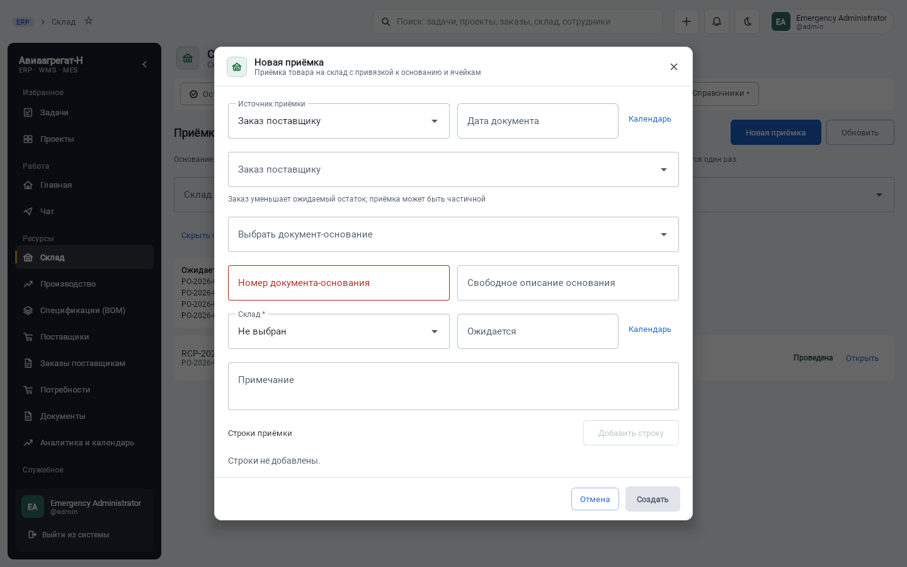

| Поле | Что вводить |
|---|---|
| **Источник приёмки** | Основание прихода: *Заказ поставщику*, *Счёт на оплату*, *Накладная/УПД*, *Возврат*, *Перемещение*, *Начальный остаток*, *Прочий документ*. От выбора зависят поля ниже. |
| **Дата документа** | Дата документа-основания (накладной, УПД, счёта). |
| **Заказ поставщику** | Для источников «Заказ», «Счёт», «Накладная». Привязывает приёмку к заказу: принятое количество уменьшит остаток по заказу. Приёмка может быть частичной. |
| **Счёт поставщика** | Только для источника «Счёт» — выбор загруженного счёта; номер, дата и заказ подставятся. |
| **Выбрать документ-основание** | Выбор документа из раздела «Документы» вместо ручного ввода номера. |
| **Номер документа-основания** | Номер накладной, УПД, заказа. Обязателен для всех источников, кроме «Начальный остаток» и «Прочий документ» (поле подсвечено красным, пока пустое). При выборе заказа подставляется его номер. Один документ проводится только один раз. |
| **Свободное описание основания** | Пояснение своими словами, например «Возврат с участка сборки». |
| **Склад \*** | На какой склад принимаем. Без него нельзя добавить строки. |
| **Ожидается** | **Плановая дата прихода груза** (см. ниже). Необязательно. |
| **Примечание** | Комментарий к документу. |
| **Заполнить из заказа** | Появляется, когда выбраны заказ и склад: создаёт строки по позициям заказа, которые склад ещё не принял полностью. Если принято всё — строки не добавляются и появляется подсказка «Все позиции заказа уже приняты складом». |
| **Добавить строку** | Добавить строку вручную. |

#### Почему в приёмке есть поле «Ожидается»?

Документ приёмки не обязательно создаётся, когда груз уже у ворот. Его можно завести **заранее**, черновиком: известно, что поставщик привезёт товар, например, в пятницу. Поле **«Ожидается»** — это **плановая дата прихода**. Она показывается в карточке приёмки («Ожидается: 28.11.2026»), чтобы кладовщик видел, когда ждать машину.

- Поле **необязательно** и **ни на что не влияет**: не меняет остатки и не блокирует проведение.
- Если товар уже привезли и вы оформляете приёмку по факту, **оставьте поле пустым**.
- Время фактической приёмки система записывает сама при нажатии **«Провести»**.

**Строки приёмки** (после «Заполнить из заказа» или «Добавить строку»):

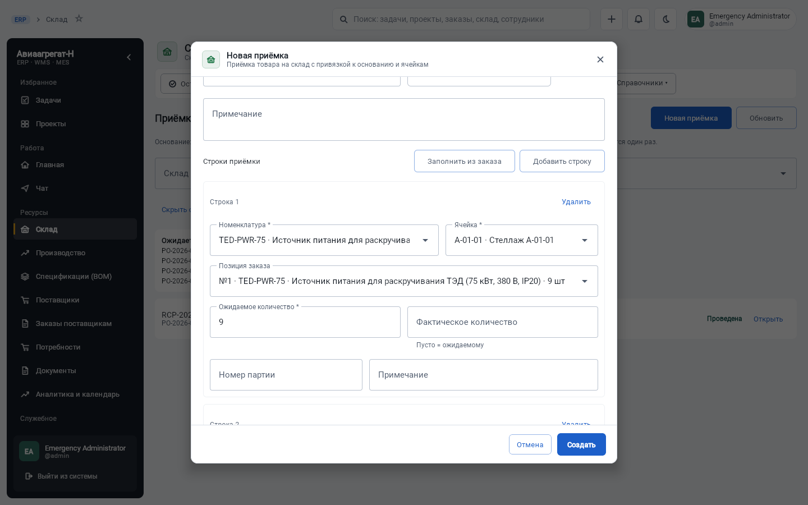

| Поле | Что вводить |
|---|---|
| **Номенклатура \*** | Что принимаем. |
| **Ячейка \*** | Куда кладём, например `A-01-01`. Без ячейки документ не проводится. |
| **Позиция заказа** | Какую строку заказа закрывает этот приход. Подставляется при «Заполнить из заказа». |
| **Ожидаемое количество \*** | Сколько должно прийти по документу. «Заполнить из заказа» подставляет остаток: заказано минус уже принятое по проведённым приёмкам. Если привезли другое количество, впишите его в «Фактическое количество». |
| **Фактическое количество** | Сколько реально пересчитали. **Пусто = ожидаемому.** |
| **Обоснование расхождения \*** | Появляется, если факт не равен ожидаемому. Недопоставка или излишек без обоснования не принимаются. |
| **Номер партии** | Номер партии или плавки. Обязателен (со звёздочкой), если у номенклатуры включён партионный учёт. |
| **Примечание** | Комментарий к строке. |
| **Удалить** | Убрать строку. |

Кнопка **«Создать»** сохраняет документ черновиком — **остатки ещё не изменились**.

### 5.4. Карточка приёмки: факт и проведение

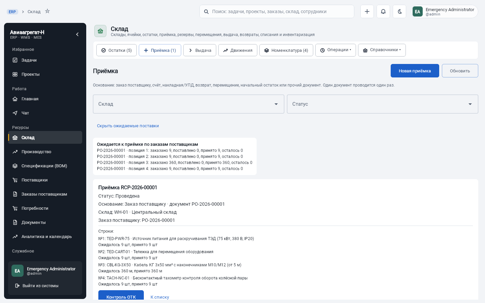

В карточке: статус, основание и номер документа, склад, заказ поставщику, дата «Ожидается» (если указана), строки «Ожидалось … / принято …», недопоставки и излишки.

У черновика и приёмки «В работе» есть блок **«Приёмка на складе: факт, ячейка, расхождения»**. Через него склад принимает и поступления, которые оформило снабжение по счёту:

| Поле | Что вводить |
|---|---|
| Принято | Фактически пересчитанное количество по строке. |
| Ячейка | Куда положили. |
| Партия | Номер партии, если ведётся. |
| Причина расхождения (обязательно) | Появляется, если «Принято» не равно ожидаемому. |
| Открыть счёт | Для поступления по счёту — скачать файл счёта и сверить с грузом. |

1. Заполните все строки и нажмите **«Сохранить факт приёмки»**. Кнопка неактивна, пока у каждой строки нет ячейки и количества.
2. Нажмите **«Провести»** — товар появится на остатках, заказ пересчитает «принято / осталось». Если в блоке приёмки есть несохранённые правки, «Провести» неактивна и под формой написано «Есть несохранённые изменения»: сначала сохраните факт, иначе провелись бы старые значения.
3. После проведения доступна кнопка **«Контроль ОТК»** — входной контроль: «Комментарий ОТК» и «Принять всё (ОТК)».
4. Если заказ или накладная появились после приёмки, у проведённой приёмки есть блок **«Связать с документами, появившимися позже»**. Остаток при этом не пересоздаётся.

### 5.5. Выдача

Вкладка **«Выдача»** — документы `ISS-…`: номер, основание, статус, когда выдано.

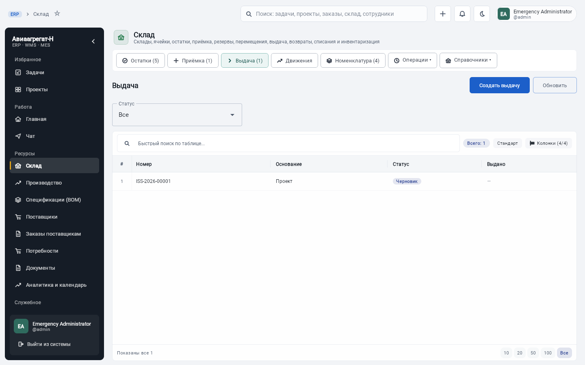

**Создать выдачу**:

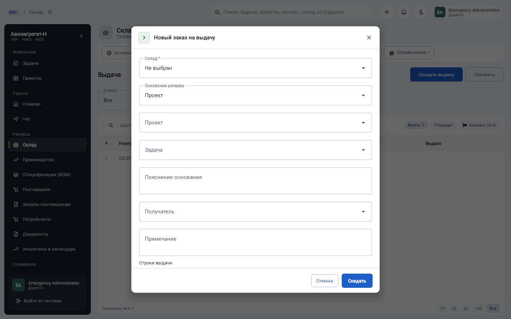

| Поле | Что вводить |
|---|---|
| Склад \* | Откуда выдаём. |
| Основание резерва | Проект, Производственный заказ, Задел, Ремонт, Задача подразделения, Прочее. |
| Проект / Задача | Для основания «Проект» выберите проект, поле «Задача» оставьте пустым. |
| Пояснение основания | Для чего выдаём. |
| Получатель | Кто забирает и затем подтверждает получение. |
| Примечание | Комментарий. |
| Строки: Номенклатура \*, Запрошенное количество \*, Резерв (необязательно) | Что и сколько выдать. Если под это уже есть резерв, выберите его — выдача пойдёт из резерва. |

**Карточка выдачи** (щелчок по строке):

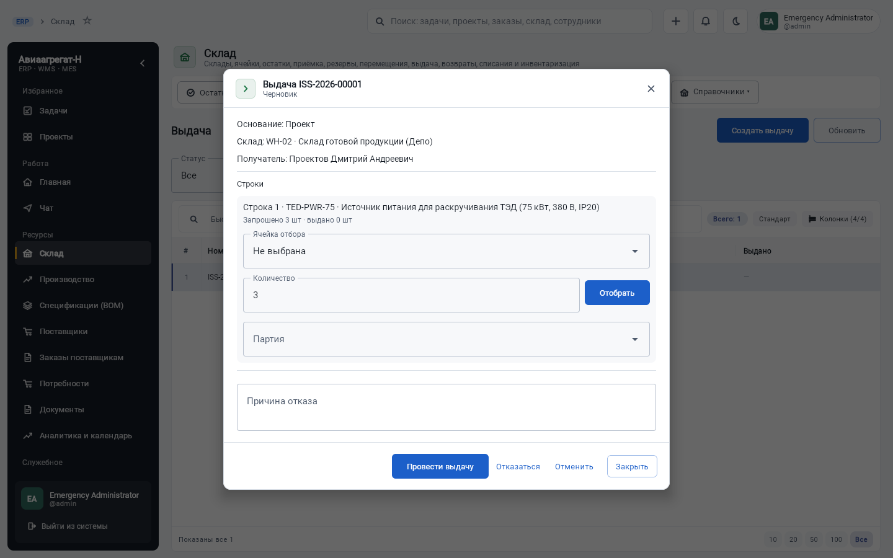

1. По каждой строке выберите **Ячейку отбора**, **Количество**, при необходимости **Партию** и нажмите **«Отобрать»**.
2. **«Провести выдачу»** — документ переходит в статус «Выдано», но остаток **ещё не меняется**. Без отбора будет ошибка «Nothing picked for the issue order».
3. Получатель нажимает **«Подтвердить получение»** (статус «Получено») — только в этот момент товар списывается с ячеек и появляется запись в журнале движений.
4. **«Отказаться»** — с заполненной «Причиной отказа»; **«Отменить»** — только для черновика.

### 5.6. Резервы (Операции ▾ → Резервы)

Резерв закрепляет остаток за проектом, заказом или задачей: «Доступно» уменьшается, «Физически» — нет.

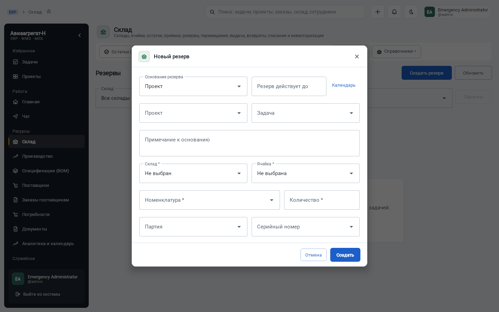

| Поле | Что вводить |
|---|---|
| Основание резерва | Проект, Производственный заказ, Задел, Ремонт, Задача подразделения, Прочее. |
| Резерв действует до | Срок, до которого держать резерв. |
| Проект / Задача | Под что резервируем. |
| Примечание к основанию | Пояснение. |
| Склад \*, Ячейка \* | Где лежит резервируемый товар. |
| Номенклатура \*, Количество \* | Что и сколько. Не больше доступного. |
| Партия, Серийный номер | Если нужно закрепить конкретную партию или экземпляр. |

### 5.7. Перемещения (Операции ▾ → Перемещения)

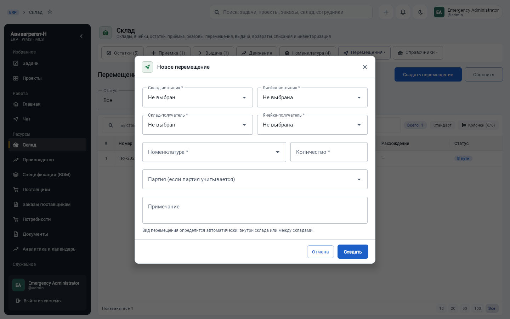

| Поле | Что вводить |
|---|---|
| Склад-источник \*, Ячейка-источник \* | Откуда берём. |
| Склад-получатель \*, Ячейка-получатель \* | Куда кладём. Ячейки не должны совпадать. |
| Номенклатура \*, Количество \* | Что и сколько. Не больше доступного. |
| Партия | Если учитывается партия. |
| Примечание | Комментарий. |

Вид перемещения (внутри склада или между складами) определяется автоматически. Порядок: **Отгрузить** → **В путь** → **Принять** (указать «Принятое количество»; при недостаче статус «Расхождение»). Пока перемещение в пути, товар числится в ячейке `IN-TRANSIT` и недоступен.

### 5.8. Возвраты, списания, инвентаризация (Операции ▾)

- **Возвраты** — возврат ранее выданного: *Склад*, *Заказ на выдачу*, *Карантинная ячейка* (в списке только активные ячейки с назначением «Карантин»; если их нет, заведите ячейку в «Справочники → Ячейки»), *Причина возврата*, строки (*Строка выдачи*, *Количество*). Товар сначала попадает в карантин («Принято на карантин»), затем по результату проверки — в годные (указать «Ячейку размещения») или в брак, кнопка «Применить решение».
- **Списания** — *Склад*, *Основание списания*, *Примечание*, строки (*Номенклатура*, *Ячейка списания*, *Количество*). Статусы: Черновик → На согласовании → Согласовано → Проведено.
- **Инвентаризация** — *Склад*, *Зона или ячейка*, *Номенклатура*, *Примечание*. Порядок: **Зафиксировать срез** → ввести «Фактическое количество» → **Сохранить подсчёт** → **Согласовать** → **Провести**.

### 5.9. Движения, номенклатура, справочники

- **Движения** — журнал всех операций с остатками (приход, расход, перемещение, списание) и список позиций с низким остатком.
- **Номенклатура** — карточки позиций: код, тип, единица, партионный/серийный учёт, страховой запас, остатки. Здесь **«Ожидается»** означает количество: заказано минус принято по отправленным заказам.
- **Справочники ▾ → Склады / Ячейки** — склады (`WH-…`) и ячейки. Назначение ячейки: *Хранение*, *Приёмка*, *Отгрузка*, *Карантин*, *Брак*, *Временное*. Из «Карантина» и «Брака» обычная выдача запрещена.

---

## 6. Администрирование (для администратора)

Раздел **«Администрирование»** содержит 4 вкладки: **Пользователи**, **Подразделения**, **Роли**, **Журнал аудита**.

- **Пользователи:** создание учётных записей, смена подразделения, сброс пароля и деактивация.
  - **Осторожно при редактировании!** Если в окне изменения пользователя поставить галочку **«Изменить роли (заменяет текущий набор)»**, нужно заново отметить все нужные ему роли — иначе старые роли сотрутся.
- **Подразделения:** дерево отделов и назначение руководителей.
- **Роли:** просмотр ролей (`ADMIN`, `PM`, `BUYER`, `KEEPER`, `ENGINEER`, `MASTER`, `SUPPLY_CHIEF`) и привязанных к ним прав.
- **Журнал аудита:** история всех действий в системе (кто, когда и что создал, изменил или отправил).

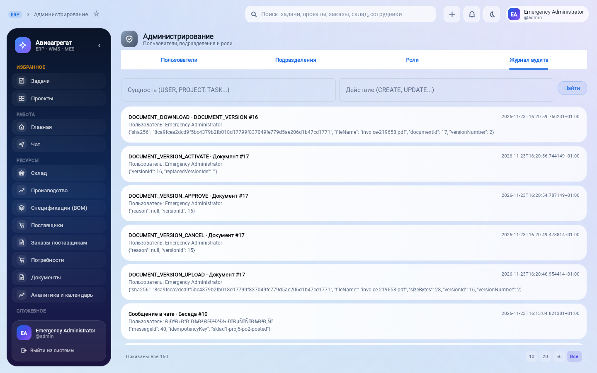

---

## 7. FAQ — Частые вопросы и решения проблем

**1. Почему я создал проект, а он называется «Черновик (откройте проект)»?**  
Все новые проекты создаются как черновик. Зайдите в проект и нажмите «Открыть проект», указав короткую причину. При этом добавлять участников, создавать задачи и писать в чат проекта можно сразу.

**2. Почему при создании задачи система ругается и не сохраняет?**  
Проверьте два частых момента:
- Выбран тип задачи **с приёмкой (`REVIEWED`)**, но не заполнены **«Критерии приёмки»** или не указан **Проверяющий**.
- Срок задачи введён в неверном формате (пользуйтесь кнопкой календаря).

**3. Почему у обычной задачи нет кнопки «Отправить на приёмку»?**  
Кнопка приёмки есть только у задач типа `REVIEWED` (с проверкой). Обычная задача (`GENERAL`) закрывается после отправки результата без отдельного этапа приёмки.

**4. Почему в окне «Заказ поставщику» нечего выбрать в поле «Предложение»?**  
Заказ создаётся только из **выбранного предложения (статус «Выбрано»)**. Если ни одного предложения ещё не выбрали, перейдите в **«Поставщики» → «Предложения»** и выберите подходящее (или попросите сделать это инициатора потребности).

**5. Я снабженец и создал нового поставщика и предложение, почему не могу оформить заказ?**  
Для заказа нужны два предварительных шага от уполномоченных сотрудников:
1. Поставщик должен пройти проверку (**статус `VERIFIED`**).
2. Предложение должен выбрать **инициатор потребности** (или пользователь с правом выбора любых предложений).

**6. Почему я (снабженец) отправил заказ на согласование, но не могу отправить его поставщику?**  
После статуса **«На согласовании» (`PENDING_APPROVAL`)** согласующий с правом `suppliers:approve_order` должен нажать **«Согласовать»** (статус «Согласован»). Только потом появится кнопка «Отправить поставщику». Если после согласования заказ правили и появилась метка «Нужно согласование», нужно согласовать его повторно.

**7. Почему склад не видит заказ в «Ожидаемых поступлениях»?**  
Склад видит только заказы, которые уже **отправлены поставщику** (статус `SENT`, `PARTIALLY_DELIVERED` или `DELIVERED`). Черновики и заказы на согласовании кладовщику не показываются.

**8. Я оформил приёмку на складе, но в «Остатках» товар не появился. Почему?**  
Вы сохранили **черновик приёмки (`DRAFT`)**. Чтобы товар зачислился на остатки, откройте приёмку и нажмите **«Провести» (`POSTED`)**.

**8а. Зачем в окне приёмки поле «Ожидается», если товар уже принимают?**  
Это **плановая дата прихода**, а не статус. Приёмку можно завести заранее, до приезда машины, и указать, когда её ждать. Поле необязательное и ни на что не влияет: если оформляете приёмку по факту, оставьте его пустым. Подробнее — в разделе 5.3.

**8б. В очереди «Ожидается к приёмке» написано «поставлено 0, принято 9». Это ошибка?**  
Нет. «Поставлено» считает поставки, зарегистрированные снабжением в заказе (кнопка «Принять» в карточке заказа), а «принято» — проведённые приёмки склада. Если снабжение поставку не регистрировало, а склад принял товар, будет именно так. «Осталось» считается по принятому складом.

**9. На складе товар «Физически» есть, а «Выдать» или «Переместить» не даёт — пишет, что не хватает количества.**  
Смотрите колонку **«Доступно»**, а не «Физически». Часть товара может быть **«В резерве»** под другой заказ либо находиться в ячейке **«Карантин / брак»**, откуда обычная выдача запрещена.

**10. При попытке выдать товар со склада появляется ошибка «Nothing picked for the issue order».**  
Перед нажатием «Выдать» нужно указать, из какой конкретно ячейки берётся товар: откройте документ выдачи и выполните подбор (**«Отобрать»** из ячейки).

**11. Почему не получается создать счёт поставщика без файла?**  
По правилам системы к счёту поставщика обязательно прикрепляется скан/файл документа. Сначала прикрепите файл, затем сохраните счёт.

**12. Появилась ошибка «Конфликт версий / Запись была изменена другим пользователем» (`409 Conflict`). Что делать?**  
Кто-то из коллег обновил этот документ/задачу раньше вас, пока карточка была у вас открыта. Нажмите **«Обновить»**, проверьте актуальный статус и повторите действие.

**13. Что делать, если в списке после создания записи её сразу не видно?**  
Нажмите кнопку **«Обновить»** в правом верхнем углу таблицы — список подгрузит свежие данные с сервера.
